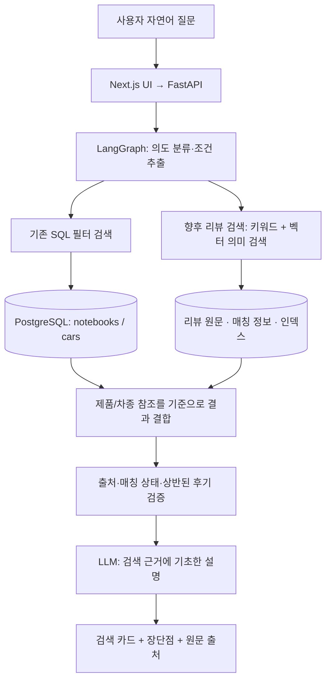

# SpecFinder AI — 사용자 리뷰 데이터 및 RAG 검색 확장 구상

> **문서 유형:** 향후 기능 확장을 위한 기획·설계 메모 (구현 지시서 또는 확정 API 계약 아님)  
> **작성일:** 2026-11-15  
> **권장 저장 경로:** `docs/REVIEW_RAG_EXPANSION_PLAN.md`  
> **기준:** SpecFinder AI의 현행 SQL 검색·LangGraph 자연어 검색 구조 및 리뷰/RAG 관련 설계 대화

## 1. 한눈에 보는 결론

**현재 보유한 노트북·중고 전기차 CSV에는 본 문서에서 구상하는 별도의 사용자 리뷰 데이터셋이 없다.** 향후 리뷰를 수집하면 기존 제품/차량 데이터를 바꾸거나 원본 CSV에 리뷰를 덧붙이는 대신, **새로운 리뷰 저장 구조를 만들고 기존 제품 또는 차량 모델과 매칭**해 활용한다.

- **기존 제품 DB:** “이 제품의 가격·RAM·무게·연식·주행거리는 무엇인가?”에 답한다.
- **향후 리뷰 DB:** “사용자가 소음·발열·승차감 등에 관해 어떤 경험을 남겼는가?”에 답한다.
- **SQL 검색:** 가격·사양·연식처럼 정확한 조건 검색 및 리뷰 개수·평점 같은 집계를 담당한다.
- **텍스트/벡터 의미 검색:** 리뷰에서 비슷한 뜻의 문장을 찾아낸다.
- **RAG + LLM:** 실제로 검색된 리뷰를 근거로 장단점, 상반된 의견, 사용 조건을 설명하고 출처를 제시한다.

**RAG는 벡터 검색과 동의어가 아니다.** 벡터 검색은 자료를 찾는 방법 중 하나이고, RAG(Retrieval-Augmented Generation)는 검색한 근거를 LLM의 답변 생성에 제공하는 전체 접근 방식이다. 의미 검색에는 키워드 검색과 벡터 검색을 결합하는 방식도 사용할 수 있다.

## 2. 현재 구현 상태와 향후 기능의 경계

| 항목 | 현재 구현 상태 | 리뷰/RAG 확장 시 |
|---|---|---|
| `notebooks` | PostgreSQL 테이블, 노트북 **2,181건** | **유지**; 제품 사양/가격 조건 검색 |
| `cars` | PostgreSQL 테이블, 전기차 매물 **302건** | **유지**; 매물 조건 검색 |
| 원본 CSV | 다나와 노트북 / K Car 자동차 데이터 | **원본 보존**; 리뷰를 여기에 병합하지 않음 |
| FastAPI | 기존 SQL 검색 API 및 `/api/ai/search` | 리뷰 검색·집계 서비스 연동 |
| LangGraph | 자연어 의도 분류 → 필터 추출 → 검증 → 검색 → 설명 흐름 | 질문 유형에 맞춰 리뷰 검색·근거 요약 단계 추가 |
| 실제 LLM 연결 | **미완료** (기본 어댑터는 `503 AI_MODEL_UNAVAILABLE`) | 연결 이후 검색된 리뷰를 근거로 설명 |
| 리뷰 저장소·임베딩 | **미구현** | 별도 설계·수집·적재 필요 |
| RAG/벡터 검색 | **미구현** | 추후 단계에서 도입 여부 결정 |

**주의:** `LangGraph` 코드가 병합되었다고 해서 실제 모델 호출, 사용자 리뷰 수집, RAG 검색까지 구현된 것은 아니다. 이 문서는 해당 기능을 **나중에 확장할 때의 설계 방향**을 기록한다.

## 3. 리뷰 데이터를 왜 별도로 수집해야 하는가?

노트북·자동차 CSV는 가격과 사양처럼 **정형 데이터** 중심이다. 반면 사용자 리뷰는 자연어 문장에 주관적인 경험, 상황, 장단점이 담겨 있다.

예를 들어 사용자는 “팬 소음이 적은 노트북”을 찾지만, 리뷰에는 다음처럼 여러 표현이 있을 수 있다.

- “도서관에서 써도 거의 조용해요.”
- “평소에는 팬이 돌아가는지 잘 모르겠어요.”
- “고부하 작업을 시작하면 팬 소리가 상당히 커져요.”

단순 키워드 일치만으로는 이 표현들을 충분히 다루기 어렵다. 의미 검색은 관련 내용을 찾아주는 데 도움을 주고, LLM은 **일반 작업과 고부하 작업이라는 차이**까지 보존하면서 요약하도록 설계할 수 있다.

**그러나** 일부 관련 리뷰를 찾았다는 이유만으로 “사용자 80%가 만족한다”, “발열 문제가 가장 적다”처럼 전체 사용자 비율이나 순위를 단정해서는 안 된다. 그런 주장은 전체 리뷰 또는 대표성 있는 표본의 분류·집계가 필요하다.

## 4. 데이터 연결 방식: 노트북과 중고차는 다르다

### 4.1 노트북: 제품 코드 및 실제 구성 기준 매칭

- 기존 `notebooks`의 식별자(제품 코드)를 리뷰와 연결하는 기준으로 활용한다.
- 단, **같은 브랜드·제품군이라도 CPU·RAM·GPU 등이 다른 구성**의 리뷰를 무조건 합쳐서는 안 된다.
- 원문에 구성 정보가 없으면 `configuration_unknown`처럼 **불확실성을 표현**하는 방식을 고려한다.
- 모델명 문자열이 유사하다는 이유만으로 자동 확정하지 않고, 제품 코드·공식 모델명·구성 정보를 교차 확인한다.

**개념 예시(실제 확보 리뷰 아님):**

| 제품 참조 | 리뷰 원문 | 검색 관점 |
|---|---|---|
| 노트북 ID `11944365` | “팬 소음이 작고 휴대하기 편리해요.” | 저소음·휴대성 |

### 4.2 중고 전기차: 개별 매물과 차종 경험을 구분

현재 `cars`는 **개별 중고차 매물** 데이터다. “2022년식 아이오닉 5의 승차감” 리뷰는 특정 중고 매물 한 대에 대한 리뷰가 아니라 **차종·세대·연식·트림·구동방식**에 대한 경험일 수 있다.

따라서 리뷰의 대상 범위를 명확히 나눈다.

1. **매물 관련 리뷰:** 특정 매물 또는 판매 경험이 명확히 식별되는 자료. 식별·출처 확인이 필요하다.
2. **차종/모델 관련 리뷰:** 아이오닉 5 등 차량 모델에 관한 사용자 경험. 가능한 한 연식·트림·배터리·구동방식 수준까지 매칭한다.

차종 리뷰를 개별 매물의 **차량 상태, 배터리 건강도(SOH), 사고 이력, 현재 재고**에 대한 증거로 오용해서는 안 된다.

### 4.3 리뷰 ↔ 제품 매칭 원칙

- 원문 리뷰와 출처를 보존하고, 제품/차종 매칭 근거를 별도로 기록한다.
- `matched`, `uncertain`, `unmatched`처럼 매칭 신뢰 상태를 표현하는 방안을 검토한다.
- 모호한 매칭 자료는 해당 제품을 확정 추천하는 근거에서 제외하거나 사용자에게 불확실성을 보여준다.
- 같은 리뷰의 중복 수집, 재게시, 광고성·협찬성 리뷰를 식별하고 취급 방침을 둔다.

## 5. 향후 데이터베이스 구조 (개념안)

현재 두 테이블을 유지하고, 후속 단계에서 리뷰 저장 구조를 추가한다. 아래 필드는 **예시 설계**이며 실제 스키마/마이그레이션이 확정된 것은 아니다.

| 개념 필드 | 용도 |
|---|---|
| `review_id` | 리뷰 고유 식별자 |
| `subject_domain` | `notebooks` 또는 `cars` |
| `subject_scope` | 제품 구성 / 차종·트림 / 특정 매물 등 리뷰의 적용 범위 |
| `subject_ref` | 확인된 제품 코드 또는 정규화된 차량 모델 참조 |
| `match_status`, `match_basis` | 연결 신뢰 상태 및 판단 근거 |
| `review_text` | 출처가 확인된 리뷰 본문 |
| `rating` | 원문에 실제 평점이 있는 경우에만 |
| `reviewed_at`, `collected_at` | 작성 시점 / 수집 시점 분리 |
| `source_url`, `source_name` | 원본 출처 추적 및 근거 링크 |
| `usage_context`, `review_tags` | 작업 부하·환경·소음·발열 등 추출된 정보(검증 필요) |
| `embedding` 또는 별도 임베딩 테이블 | 문장 의미 검색을 위한 벡터(도입 시) |

처음부터 모든 정보를 단일 `reviews` 테이블에 넣을 필요는 없다. 실제 수집 대상과 매칭 관계를 살펴보고 **리뷰 원문 테이블·제품 연결 테이블·임베딩 저장소를 분리할지** 결정한다.

벡터 검색 저장소는 기존 PostgreSQL에 **`pgvector` 확장**을 쓰는 방안부터 검토할 수 있다. 하지만 리뷰 규모, 검색 품질, 비용을 평가하기 전까지 새 DB·테이블·확장 도입은 확정하지 않는다.

## 6. 검색 아키텍처: SQL + 리뷰 의미 검색 + RAG

핵심 원칙은 **정확한 숫자 필터는 SQL, 자연어 경험 검색은 텍스트/벡터 검색, 근거 기반 설명은 RAG + LLM**이 담당하도록 분리하는 것이다.

### 예시 A — 복합 검색

> “150만 원 이하에서 발열이 적다는 후기가 많은 노트북 찾아줘.”

1. LLM이 확실한 정형 조건 `max_price_krw=1500000`을 추출한다.
2. SQL이 조건에 맞는 노트북 후보와 실제 제품 식별자를 조회한다.
3. 관련 제품에 연결된 리뷰에서 **발열/뜨거움/온도** 등을 다룬 문장을 검색한다.
4. 리뷰를 **긍정·부정 및 사용 환경**에 따라 분류하고, 필요하다면 집계의 모집단·표본 기준을 제시한다.
5. LLM이 근거가 있는 항목만 요약하고 **리뷰 출처와 상반된 의견**을 함께 보여준다.

“후기가 많다”는 표현에는 **명확한 개수·비율 기준**이 필요할 수 있으며, 의미 검색 결과 몇 개만으로 충족했다고 판단하지 않는다.

### 예시 B — 질문형 RAG

> “이 노트북의 팬 소음에 대해 실사용자들이 뭐라고 하나요?”

관련 제품으로 확인된 리뷰를 검색해, “일상 사용에서는 조용함”과 “고부하 작업 시 소음 증가”처럼 **조건에 따른 차이**를 출처와 함께 설명한다. 충분한 근거가 없다면 그 한계를 명시한다.

### 예시 C — 전기차 주의 사항

> “2022년식 아이오닉 5 승차감 후기 알려줘.”

해당 연식·트림과 관련된 리뷰를 우선 검색하되, 차종 전체에 대한 일반적인 후기인 경우 **특정 연식/트림에 직접 적용되는 근거가 아니라는 점**을 표시한다. 리뷰를 근거로 개별 중고차 매물 상태를 단정하지 않는다.

## 7. SQL 통계와 RAG를 구분한다

| 사용자 요구 | 담당 기능 | 주의 사항 |
|---|---|---|
| “가격 150만 원 이하” | SQL | 정형 컬럼 기준 |
| “RAM 16GB 이상” | SQL | 정형 컬럼 기준 |
| “도서관에서 조용한 편인가?” | 리뷰 키워드·의미 검색 + RAG | 작업 상황과 반대 후기 함께 제시 |
| “평점 평균은?” | SQL 집계 | 평점 있는 리뷰만, 표본 수 표시 |
| “발열 만족도가 80%인가?” | 리뷰 분류 + 모집단을 정의한 통계 | 일부 검색된 리뷰를 전체 대표로 간주하지 않음 |
| “장단점 비교해 줘” | 제품별 리뷰 검색 + LLM 근거 요약 | 서로 다른 구성·차종 리뷰 혼합 주의 |

## 8. 리뷰 수집 시 필수 고려 사항

1. **수집 및 사용 권한:** 사이트 약관, 저작권, 접근 제한, API·재배포 허용 범위를 사전에 확인한다. 허용되지 않은 수집을 전제로 설계하지 않는다.
2. **개인정보 최소화:** 작성자의 아이디·이름·연락처 등은 수집이 필요한지 검토하고, 불필요한 개인정보는 저장하지 않는다.
3. **제품 매칭 정확성:** 노트북 구성·차량 모델/연식/트림과 리뷰 대상이 실제로 일치하는지 검증한다.
4. **중복·편향·광고성 후기:** 동일한 원문, 협찬 후기, 극단적인 평가의 편향을 점검한다.
5. **출처 및 시점:** 원문 출처와 작성·수집 시점을 분리해 추적한다.
6. **프롬프트 인젝션 방어:** 리뷰는 신뢰되지 않는 외부 텍스트다. 리뷰에 적힌 “시스템 지시”를 LLM의 명령으로 실행하지 않는다.
7. **근거와 통계의 분리:** 소수의 검색 사례를 전체 사용자 평가의 통계로 일반화하지 않는다.
8. **검색 품질 평가:** 의미 검색에서 관련성뿐 아니라 모델 매칭 정확도, 최신성, 출처 회수율을 점검한다.

## 9. 개발 순서 제안

### 1단계 — 현행 AI 검색 완성 (우선)

- 실제 LLM 제공자를 선정하고 `UnconfiguredLLM`을 대체할 서버 측 어댑터를 연결한다.
- 기존 `/api/ai/search` 계약과 Pydantic 검증을 유지한다.
- Gemini/Next.js 채팅 UI와 실제 PostgreSQL 검색을 연동한다.
- 한국어 필터 추출·모호한 질문·후속 대화·0건 처리의 통합 테스트를 진행한다.

### 2단계 — 리뷰 파일럿 준비

- 이용 권한이 확인된 소량의 리뷰를 확보한다.
- 노트북 제품 코드 및 전기차 모델·연식·트림의 매칭 규칙을 정의한다.
- 원문·출처·시점·매칭 신뢰 상태를 정리한다.
- 키워드 검색만으로 해결되는 질문과 의미 검색이 필요한 질문을 나눠 평가셋을 만든다.

### 3단계 — 리뷰 검색 도입

- 별도 리뷰 저장 구조와 검색 인덱스를 도입한다.
- 먼저 키워드 검색 및 제품별 필터링을 검증한다.
- 필요한 경우 임베딩과 `pgvector`를 추가해 **하이브리드 검색**을 평가한다.
- 실제로 관련된 제품의 리뷰만 검색되는지 점검한다.

### 4단계 — RAG 기반 요약·비교

- LangGraph에 리뷰 검색 및 근거 취합 단계를 추가한다.
- LLM에 검색된 자료와 출처를 제공해 요약·비교하도록 한다.
- 근거 없는 주장, 모델 혼동, 반대 의견 누락, 인용 출처 오류를 평가한다.
- 프론트엔드에 리뷰 요약·원문 출처·리뷰 수/평점의 집계 기준을 표시한다.

## 10. 아직 결정하지 않은 사항

- 리뷰 출처 및 합법적 수집·재사용 범위
- 제품/차종 표준 식별자와 리뷰-제품 연결 모델
- `reviews` 단일 테이블 또는 원문·매칭·임베딩 분리 구조
- 리뷰 수집량과 갱신 주기
- 키워드 검색만으로 충분한지, 벡터 의미 검색이 필요한지
- 임베딩 모델, `pgvector` 도입 여부 및 저장 비용
- 장단점 요약의 평가 기준, 출처 표시 UI

이 항목들은 **실제 리뷰 파일럿을 확보한 뒤** 확정하는 것이 적절하다.

## 11. 최종 정리

> **기존 제품 DB = 어떤 제품인가?**  
> **추가 리뷰 데이터 = 실제 사용자들이 어떻게 평가하는가?**  
> **SQL + 의미 검색 + RAG/LLM = 조건에 맞는 제품을 찾고, 사용자 평가를 근거와 함께 설명한다.**

현행 MVP의 `notebooks`·`cars` 테이블과 원본 CSV는 유지한다. 리뷰는 나중에 수집·정규화·제품 매칭 후 별도 저장하고, SQL의 정형 검색과 텍스트/벡터 기반 리뷰 검색을 결합한다. **현재 우선순위는 실제 LLM 연결 및 자연어 검색 통합 테스트이며, 리뷰 RAG는 후속 확장**이다.
